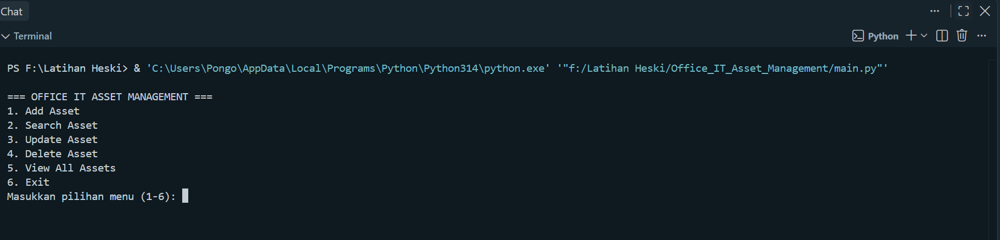
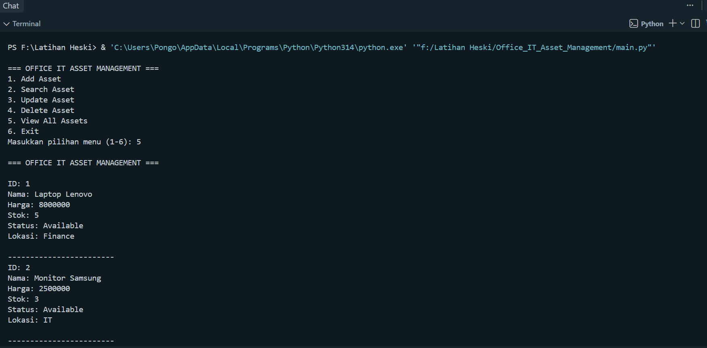
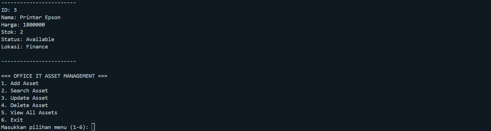
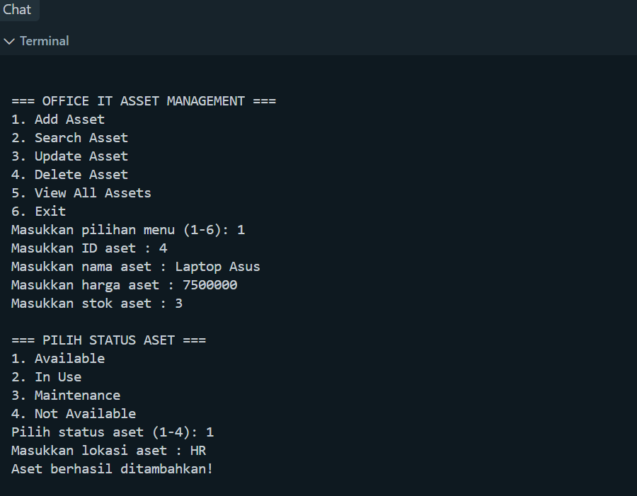
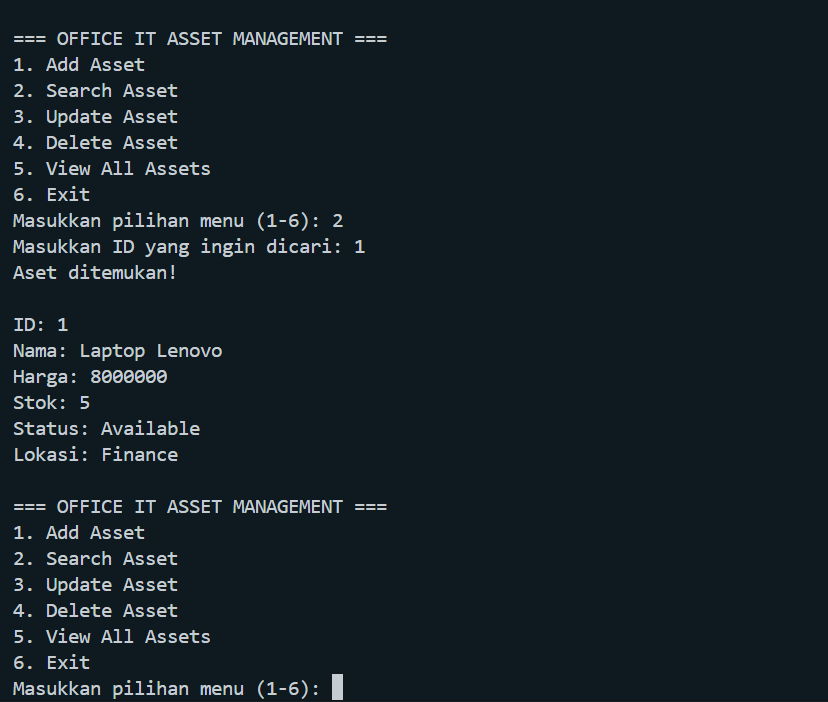
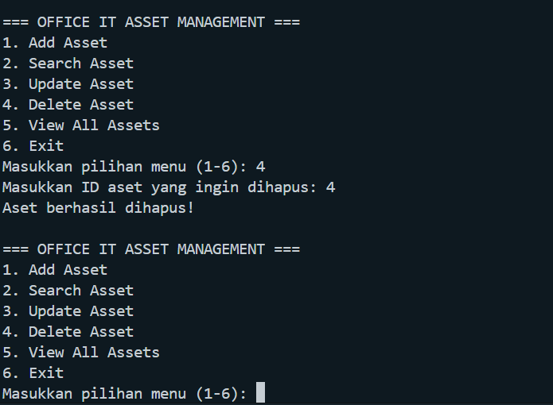
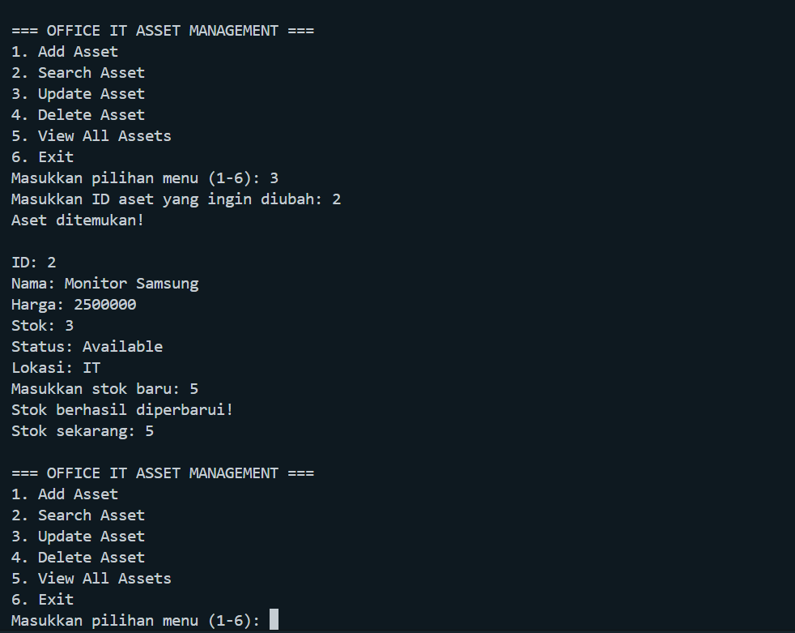

# Office IT Asset Management

## Project Description

A simple Python application designed to manage office IT assets, including asset information, stock quantities, status, and location.

## Project Objectives

- Practice Python programming through a practical project.
- Apply functions, lists, dictionaries, and JSON for data management.
- Build a simple application relevant to office IT asset management.

## Features

- Add new IT assets.
- Search assets by ID.
- Update asset stock quantities.
- Delete existing assets.
- View all registered assets.
- Store asset data using JSON for data persistence.
- Validate user input to prevent invalid data.

## Technologies Used

- Python
- JSON
- Visual Studio Code

## Project Structure

Office_IT_Asset_Management/
│
├── main.py
├── data_aset.json
└── README.md

## How to Run

1. Make sure Python is installed on your computer.
2. Open the project folder in Visual Studio Code.
3. Open the terminal.
4. Run the following command:

   python main.py

## Application Preview

### 1. Main Menu

### 2. View All Assets

### 3. Add Asset

### 4. Search Asset

### 5. Delete Asset

### 6. Update Asset

### 7. View Assets After Deletion

## Project Status

Version 1.0 - Initial Release