# Office IT Asset Management

## Project Description

A Python-based application designed to manage office IT assets, including asset information, stock quantities, status, and location.

This project was initially developed using JSON for data storage and later enhanced by migrating to a MySQL database.

## Project Objectives

- Practice Python programming through a practical project.
- Apply functions, lists, dictionaries, and JSON for data management.
- Understand relational database management using MySQL.
- Integrate Python applications with a MySQL database.
- Build a simple application relevant to office IT asset management.

## Development History

This project was developed in two stages:

### Version 1.0 - JSON-Based Storage

The initial version used JSON as its data storage mechanism. It was developed to practice Python fundamentals, including functions, lists, dictionaries, file handling, and JSON.

#### Features Version 1.0 - JSON-Based Storage
- Add new IT assets.
- Search assets by ID.
- Update asset stock quantities.
- Delete existing assets.
- View all registered assets.
- Store asset data using JSON for data persistence.
- Validate user input to prevent invalid data.

### Version 2.0 - MySQL Database Integration

The application was enhanced by migrating its data storage from JSON to MySQL.

This development introduced SQL queries, database integration, CRUD operations using MySQL, transaction handling, and environment variable management.

The project's development progression can also be explored through its Git commit history.

#### Features Version 2.0 - MySQL Database Integration

- Add new IT assets.
- Search assets by ID.
- Update asset stock quantities.
- Delete existing assets **with confirmation**.
- View all registered assets.
- Store asset data **in a MySQL database**.
- Validate user input to prevent invalid data.
- Handle database errors and transactions.

## Technologies Used

- Python
- MySQL
- MySQL Connector/Python
- python-dotenv
- SQL
- Visual Studio Code
- Git & GitHub

## Project Structure

```text
Office_IT_Asset_Management/
│
├── screenshots/
│   ├── version_1.0/
│   └── version_2.0/
│
├── .gitignore
├── main.py
└── README.md
```

## How to Run

1. Make sure Python and MySQL Server are installed.
2. Make sure the MySQL service is running.
3. Create the database and `assets` table by running the following SQL commands in MySQL:

   ```sql
   CREATE DATABASE latihan_mysql;

   USE latihan_mysql;

   CREATE TABLE assets (
       id INT AUTO_INCREMENT PRIMARY KEY,
       nama VARCHAR(100),
       harga DECIMAL(12,2),
       stok INT,
       status VARCHAR(30),
       lokasi VARCHAR(100)
   );
   ```

4. Open the project folder in Visual Studio Code.
5. Open the terminal and install the required Python packages:

   ```bash
   pip install mysql-connector-python python-dotenv
   ```

6. Create a `.env` file in the project directory and add your MySQL password:

   ```env
   DB_PASSWORD=your_mysql_password
   ```

   Replace `your_mysql_password` with your own MySQL password. Do not share or upload this file.

7. Run the application:

   ```bash
   python main.py
   ```

## Application Preview

### Version 1.0 — JSON-Based Storage

#### 1. Main Menu

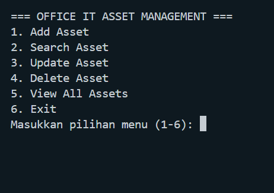

#### 2. View All Assets

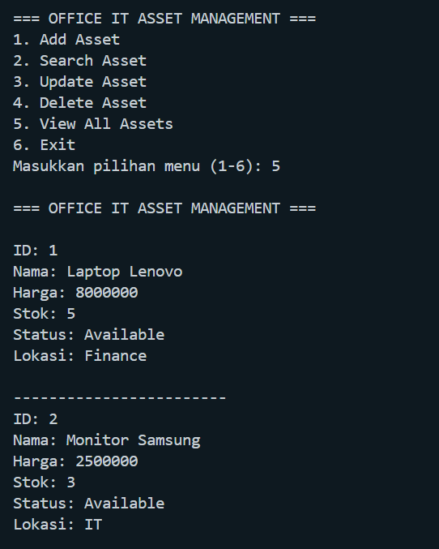

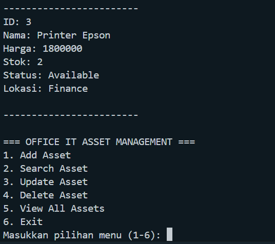

#### 3. Add Asset


#### 4. Search Asset


#### 5. Delete Asset


#### 6. Update Asset


#### 7. View Assets After Deletion

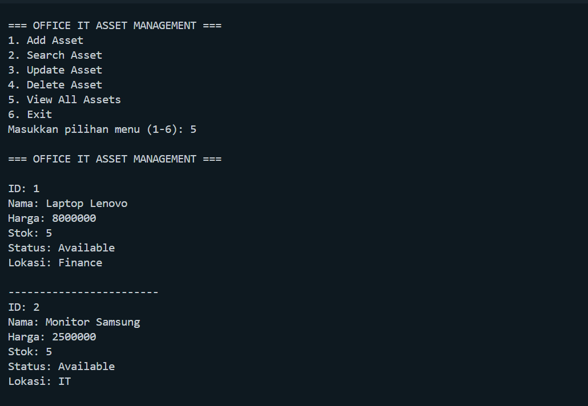

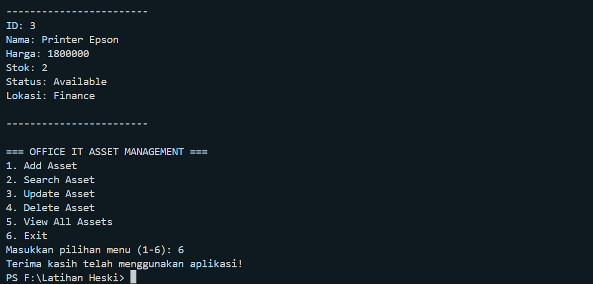

### Version 2.0 — MySQL Database Integration

#### 1. Main Menu

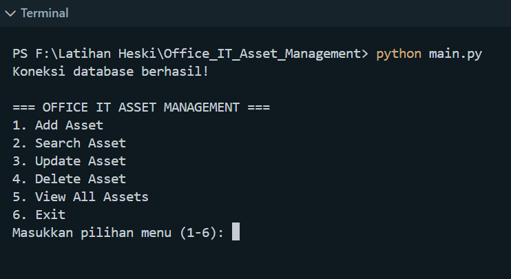

#### 2. Initial Database State

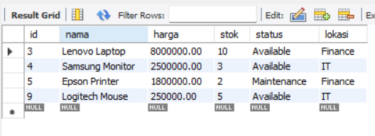

#### 3. View All Assets

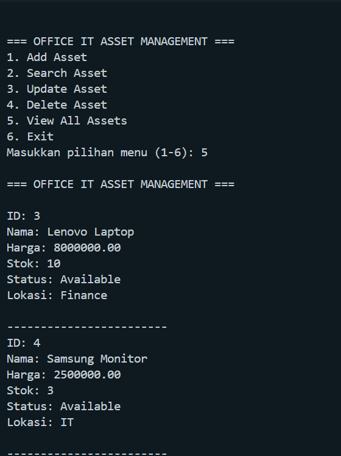

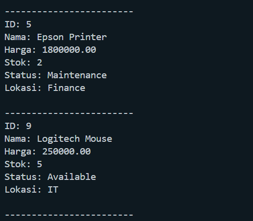

#### 4. Add Asset

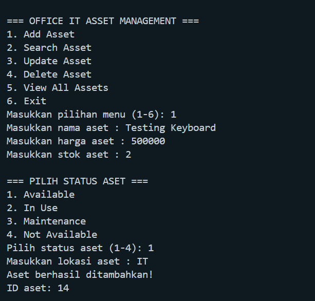

#### 5. Database After Add

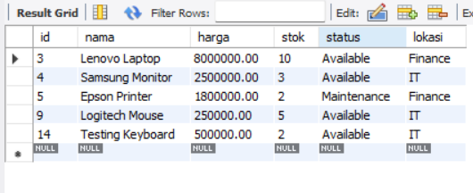

#### 6. Search Asset

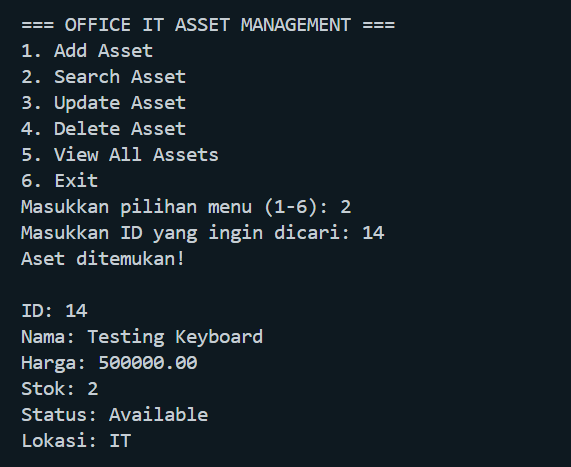

#### 7. Update Asset

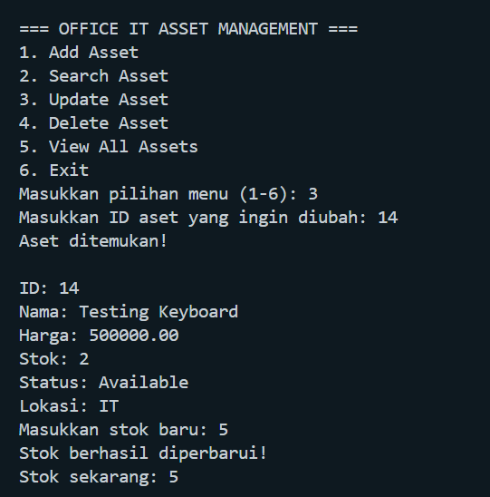

#### 8. Database After Update

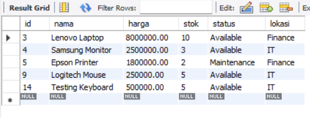

#### 9. Delete Asset

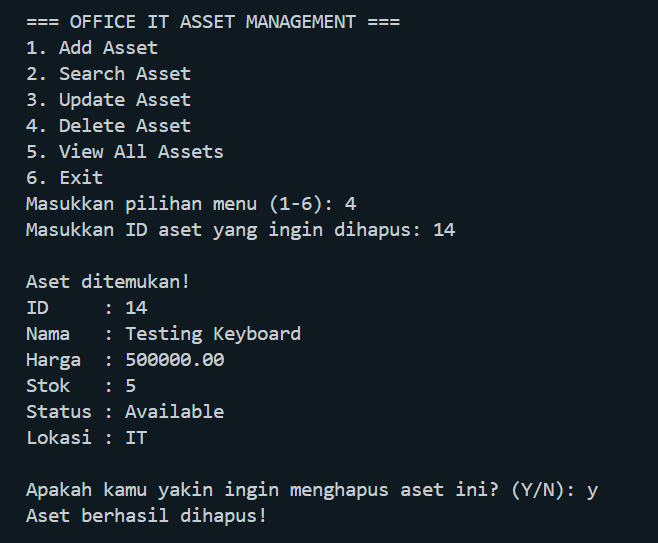

#### 10. Final Database State

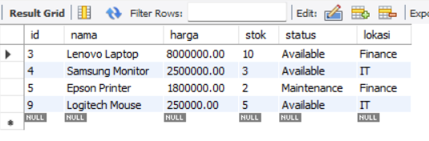

## Project Status

Version 2.0 - MySQL Database Integration

This project is maintained as a learning project and demonstrates the development of a Python-based IT asset management application, from JSON-based storage to MySQL database integration.
